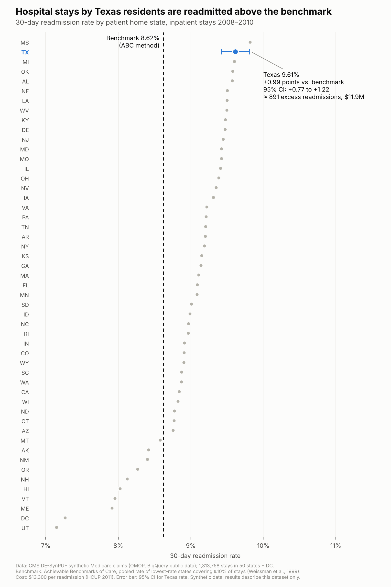

# Findings

*Synthetic Medicare data, 2008–2010. These results describe this dataset, not actual Medicare patients or hospitals.*

## The gap

Texas residents account for 90,016 hospital stays in the state comparison. Of those, 8,654 were followed by a recorded readmission, a rate of **9.61%**. The benchmark group has a pooled rate of **8.62%**.

| Measure | Texas |
|---|---|
| Hospital stays | 90,016 |
| Recorded readmissions | 8,654 |
| Readmission rate | 9.61% |
| Difference from the benchmark | +0.99 percentage points |
| Additional recorded events at that difference | about 891 |
| Estimated hospital costs at $13,300 per event | about $11.9 million |

The 891 compares the observed count with what we would expect at the benchmark rate. It does not tell us how many events were preventable. The cost estimate shows scale; it is not a savings estimate.

The existing chart's confidence-interval calculation still needs to be documented. We should not use it to rule out chance until that check is complete.

## The benchmark

Start with the states with the lowest readmission rates. Include whole states until they cover at least 10% of all stays in the state comparison, then pool their readmissions and stays.

The first 14 cover 9.32% of stays. Adding California crosses 10%, giving 15 states/DC, 225,105 stays, and 19,412 readmissions. The pooled rate is **8.62%**. This adapts the Achievable Benchmarks of Care idea; it does not include the paper's adjustment for small groups. [Weissman et al., 1999](https://pubmed.ncbi.nlm.nih.gov/10461579/)

The $13,300 cost assumption comes from rounded 2011 Medicare age-65+ hospital-cost totals. [HCUP Statistical Brief #172, Table 1](https://www.ncbi.nlm.nih.gov/books/NBK206781/table/sb172.t1/)

## What's next

Check the stay definition, then build a model to help inform the recommendation. The model should improve on a simple prediction rule. It may help identify higher-risk stays, but it cannot by itself explain why the gap exists or prove that follow-up would reduce it.

## Limits to keep in mind

- The data is synthetic, and relationships between variables were changed. It cannot establish actual Texas care quality.
- State means where the patient lives, not where they were treated.
- Claim start and end dates stand in for admission and discharge dates.
- The 2–30-day next-stay rule is a project definition that still needs checking for overlapping or adjacent claims.

See [sql/README.md](sql/README.md) for the calculation steps and [charter.md](charter.md) for the question and scope.
