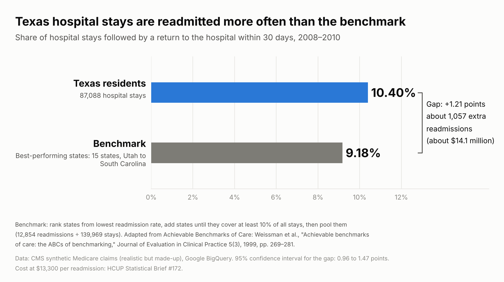

# Findings

*Synthetic (realistic but made-up) Medicare data, 2008–2010. Results describe this dataset only.*

## The problem

A *readmission* is when a patient leaves the hospital and comes back within 30 days. Hospital stays by Texas residents led to a readmission **10.40%** of the time. The *benchmark*, the rate the best-performing states achieve, is **9.18%**.

| Measure | Texas |
|---|---|
| Hospital stays | 87,088 |
| Stays followed by a readmission | 9,055 |
| Readmission rate | 10.40% |
| Above the benchmark by | 1.21 percentage points |
| Extra readmissions compared with the benchmark | about 1,057 |
| Cost of those extra readmissions, at $13,300 each | about $14.1 million |

If Texas matched the benchmark, it would have had about 1,057 fewer readmissions. Not every readmission can be prevented, so how much could actually be saved needs more study.

**Is the gap real?** A 95% confidence interval gives the range the true gap most likely falls in: **0.96 to 1.47 percentage points**. Even the low end is above zero, so the gap is very unlikely to be random chance.

## How the benchmark was set

1. Rank the states from lowest readmission rate to highest.
2. Starting with the lowest, add states one at a time until together they cover at least 10% of all hospital stays. That took 15 states, from Utah through South Carolina (139,969 stays).
3. Combine them: 12,854 readmissions ÷ 139,969 stays = **9.18%**.

Requiring 10% of all stays keeps a few small states with lucky numbers from setting an unrealistic bar. This is a simplified version of a published method, Achievable Benchmarks of Care ([Weissman et al., 1999](https://pubmed.ncbi.nlm.nih.gov/10461579/)).

The $13,300 cost per readmission comes from 2011 Medicare hospital-cost totals ([HCUP Statistical Brief #172, Table 1](https://www.ncbi.nlm.nih.gov/books/NBK206781/table/sb172.t1/)).

## The model

We built a prediction model that scores each hospital stay's chance of a readmission. So far it's weak: its score was 0.548, barely better than a coin flip (0.5). It relied most on how many times the patient had been in the hospital before, and barely used age. Details are in [model/model_card.md](model/model_card.md).

## What's next

- **Compare the model with a simple rule:** call everyone who was in the hospital in the last 6 months. If the model doesn't do better, the rule is the better choice, since it needs no model.
- **Check whether Texas's gap comes from its patients being sicker** (its *patient mix*), by comparing the readmissions the model expects for Texas patients with the 9,055 that actually happened.
- Proving that follow-up calls reduce readmissions would need a separate test.

## Limits

- The data is synthetic. CMS scrambled some relationships in the data to protect privacy, which likely weakened the model.
- "State" means the patient's home state, not where they were treated.
- The data has no exact admission and discharge dates, so we used the start and end dates on the hospital's bill instead.
- Some hospital stays were billed as several overlapping bills. We removed those duplicate pieces.
- Our readmission count is a simplified version of the official CMS measure. It doesn't exclude planned readmissions or adjust for how sick patients are.

How each number was calculated is in [sql/README.md](sql/README.md). The question and scope are in [charter.md](charter.md).
