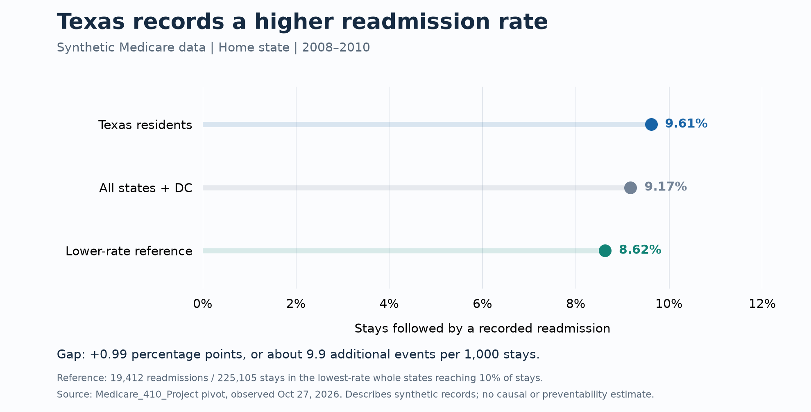

# Findings: A Readmission Difference to Investigate

**Recommendation:** validate the stay definition, then test whether a simple risk model improves follow-up prioritization. The current comparison identifies a useful question; it does not yet justify an intervention.

## What we found

The state comparison contains **1,313,758 reconstructed stays** and **120,503 recorded readmissions**. Its overall rate is **9.17%**. Texas accounts for 90,016 stays and has a higher recorded rate than the lower-rate reference group.

| Measure | Texas comparison |
|---|---|
| Recorded readmissions / stays | 8,654 / 90,016 |
| Texas readmission rate | 9.61% |
| Pooled reference rate | 8.62% |
| Difference | +0.99 percentage points |
| Difference expressed per 1,000 stays | about 10 additional recorded events |
| Count above the reference-rate expectation | about 891 events |

The 891-event difference answers: **How many fewer recorded events would there be if these Texas stays had the reference group's rate?** It does not establish that those events were avoidable.

## How we selected the reference group

Rank states from lowest to highest recorded rate. Include whole states until their cumulative share first reaches 10% of all eligible stays, then pool their readmissions and stays.

The first 14 cover 9.32% of stays. Including California crosses the threshold, bringing the group to 15 states/DC and 17.13% of stays. The pooled rate is **19,412 ÷ 225,105 = 8.62%**. This is a stay-based adaptation inspired by Achievable Benchmarks of Care; it uses raw state rates rather than the published method's small-sample ranking adjustment. [Weissman et al., 1999](https://pubmed.ncbi.nlm.nih.gov/10461579/)

## Why the size matters

Applying the project's $13,300 cost assumption to the 891-event difference gives an illustrative cost equivalent of about **$11.9 million**. The assumption is derived from 2011 Medicare age-65+ hospital-cost totals in [HCUP Statistical Brief #172, Table 1](https://www.ncbi.nlm.nih.gov/books/NBK206781/table/sb172.t1/). It illustrates scale; it is not measured savings or payments in this dataset.

## What we recommend next

First, check the reconstructed stays and outcome labels. Then compare a simple patient-risk model with a basic prediction rule, using the same follow-up capacity for both. If the model identifies more subsequent readmissions at that capacity, recommend further validation. If it does not, recommend the simpler rule. [Model plan](model/model_card.md)

## What this evidence can support

These CMS synthetic records are intended for training and development. CMS cautions that altered relationships limit inference about actual Medicare beneficiaries and providers. State means patient residence, and the dates are claim-date proxies. [CMS User Manual, printed pp. 1–2 and 16](https://www.cms.gov/Research-Statistics-Data-and-Systems/Downloadable-Public-Use-Files/SynPUFs/Downloads/SynPUF_DUG.pdf)

The rates and chart can be reproduced from the saved aggregate counts. Source-stay validation, the prediction model, and a defensible uncertainty calculation remain unfinished. The new chart therefore reports the observed comparison without the original unverified confidence interval.

[Reproduce the calculations](sql/README.md) · [Human and agent checks](audit_log.md)
